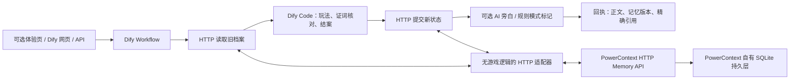

# 怪奇失物招领处

**一间会记住你胡说八道的失物招领处。** 你把“会打嗝的月亮”交给夜班柜员阿纸，编一段来历，许下一句约定。下次换个会话来，阿纸会翻出原档案，拿你的旧梗接着说。

本作品位于赛事要求的 `2026-competition-ecosystem` 分支的 `dify/` 目录，选择 **Dify + PowerContext**。不依赖 seekdb、知识库、Embedding、Rerank 或自定义插件。

## 怎么玩

一局约三分钟。同一张私人通行证关联同一份持久记忆；第一次用随机通行证，输入 `开门`。

| 输入示例 | 窗口业务 |
| --- | --- |
| `寄存 会打嗝的月亮 | 每周五变成奶酪` | 你的脑洞成为真实档案，离谱值 +2 |
| `寄存 拒绝加班的影子 | 下班后替我去月球钓鱼` | 两件怪物品串成一场“连锁事故” |
| `约定 每次见面先说咕叽` | 柜员下一次开门会主动提醒 |
| `认领 会打嗝的月亮 | 奶酪是它的周五皮肤` | 证词匹配原来历至少两个连续文字或数字，认领成功 +3 |
| `结案` | 领取专属称号和收据，腾空柜子，留下纪念物暗号 |
| `开门` / `看看` | 翻出旧约定、上一班称号与暗号；跨 Dify 用户或会话仍有效 |

认领失败不加分，重复认领不加分。每班最多三件物品，结案得分达到 10 时获得“宇宙级烂摊子收藏家”，否则为“负一楼常驻编外人员”。结案相册保留最近三班；约定持续有效，新的约定会替换旧约定。

默认是**规则剧场**：无需模型密钥、输出可复核。可选配置 OpenAI 兼容模型，为已执行结果追加 AI 碎碎念。界面明确标注本回合是否实际调用模型；AI 不修改得分、记忆或认领结果。当前交付的实际运行证据来自规则模式，未声称完成真实模型调用。

## 技术实际做了什么



Dify 的 Code 节点内包含完整玩法源码，HTTP 节点负责读取和保存，保存确认后才输出成功回执。后端不提供脱离 Dify 的游戏执行接口。可选网页的 `/play` 入口转发到真实 Dify `/v1/workflows/run`，不会本地模拟工作流。

PowerContext 1.2.0 是**唯一游戏状态存储**。每张通行证以 SHA-256 派生独立 scope 的幂等键，通过 `remember` 创建状态、`entries/revise` 更新、`entries/list` 读回；精确 citation 随 Dify 输出交付。约定、物品来历、认领状态、得分和相册都从真实记录恢复。适配器没有备用本地存档，记忆服务断开会返回错误。

## 材料入口与验证状态

| 材料 | 用途 |
| --- | --- |
| [dsl/strange-cabinet.yml](dsl/strange-cabinet.yml) | 唯一 DSL；Dify 1.9.1、DSL 0.4.0；无需导入其他 DSL |
| [docs/RUNBOOK.md](docs/RUNBOOK.md) | 安装、网络、服务地址绑定、发布、模型配置、限制 |
| [docs/LOCAL_DIFY.md](docs/LOCAL_DIFY.md) | 已实测的独立 Dify Compose 环境；自动导入、发布及完整引擎验证 |
| [docs/VERIFICATION.md](docs/VERIFICATION.md) | 初始状态、完整体验顺序、预期表现、重置方式 |
| [docs/ENGINEERING.md](docs/ENGINEERING.md) | 数据结构、一致性、来源与可追溯技术说明 |
| [evidence/README.md](evidence/README.md) | 实际已验证项和未完成项，避免混淆模拟与真实运行 |
| `game.py` / `scripts/build_dsl.py` | 核心规则源码及可重复生成 DSL 的工具 |
| `app.py` / `serve_memory.py` | 配套 HTTP 服务及真实 PowerContext 启动器 |
| `static/index.html` | 可选的单页体验窗口，通过 Dify API 游玩 |
| `compose.yaml` / `compose.dify.yaml` / `Dockerfile` | 配套服务与官方 Dify 1.9.1 引擎容器配置 |
| `scripts/verify.py` | 真实记忆服务、HTTP 适配器、DSL 内规则源码及进程重启验证 |
| `scripts/verify_dify.py` | 对已发布的真实 Dify 应用执行完整样例，生成引擎运行证据 |
| `scripts/verify_deployed_restart.py` | 重启真实部署的配套容器，核对持久化及 Dify 回访 |
| `scripts/record_deployment.py` | 记录镜像摘要、容器状态、包版本与 DSL 哈希，排除凭据 |

**真实 Dify 1.9.1 导入、绑定、发布与执行已通过。** 完整验收的 8 次运行包含 72 条全部成功的节点记录，以及配套 `/play` 入口调用；另有 4 次真实 Dify 运行验证容器重启后仍复用旧约定和纪念物。PowerContext 重启前后 state、version、scope、citation 完全一致，并通过其原始 API 读回核对。9 个部署容器已运行，镜像 / 包版本、逐轮输出和脱敏节点证据见 [运行证据](evidence/README.md)。原生十轮集成验证及 12 项规则 / 模型失败契约测试也已通过；默认无模型密钥即可体验。

## 快速启动完整作品

推荐首次体验按 [独立本地 Dify 环境](docs/LOCAL_DIFY.md) 操作：安装宿主机工具依赖、生成随机本地配置、启动 Compose、运行 `scripts/configure_dify.py --initialize`，最后重新创建适配器以读取应用 key。无需预置数据或模型供应商。入口是 [本地窗口](http://127.0.0.1:8812)，运行时由真实 Dify 编排每个回合。

## 快速启动配套服务

需要 Python 3.13（实际验证：Windows 3.13.9），在本目录执行：

```powershell
python -m venv .venv
.\.venv\Scripts\python.exe -m pip install -r requirements.txt -c constraints.txt
Copy-Item .env.example .env
# 在 .env 填写随机 CABINET_TOKEN；通行证和服务 token 不是同一种凭据。
.\.venv\Scripts\python.exe scripts/run_local.py
```

随后按 [运行说明](docs/RUNBOOK.md) 导入 DSL，在 Dify 中设置适配器地址和服务 token，运行、发布。Dify 自带界面即可体验；如使用配套网页，还需把已发布应用的 API Key 填入 `.env` 的 `DIFY_APP_KEY`，再重启配套服务。网页入口为 [本地窗口](http://127.0.0.1:8812)。

所有配置样例均为占位值；真实凭据、PowerContext 数据文件、虚拟环境和 Dify 上游临时检出目录均不提交。
